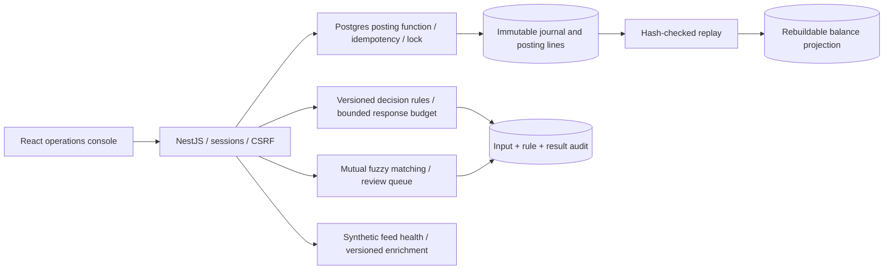
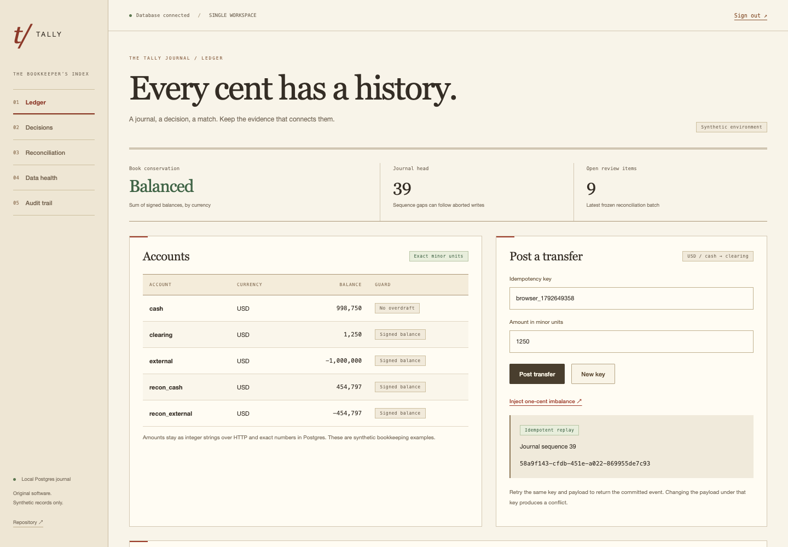

# Tally

1. **Problem:** Concurrent retries, changing rules and ambiguous financial records can silently break balances or erase the reasons behind a decision.

2. **Result:**

- Journal: 1,000 real HTTP posts across two API processes; 1,003 events replayed to identical balances; 24 concurrent retries created 1 event. API SIGKILL, lost-response retry and projection corruption/repair passed. [Raw journal campaign](docs/results/ledger.json)
- Decisions: HTTP p99 14.386 ms at concurrency 16, 400 samples, 0 failures; 1,202/1,202 stored decisions replayed exactly. Local round trips include durable audit commits; the latency target is not a production SLO. [Samples](docs/results/decisions.json)
- Matching: 151/200 bank records matched, precision 100.00%, recall 84.36%, 0 false matches on injected noise; descriptor accuracy 100.00% on 400 synthetic labeled strings. [Reconciliation](docs/results/reconciliation.json) · [Enrichment](docs/results/enrichment.json)

3. **Architecture:**





[Visual design references and UI checks](docs/UI.md) · [Redesigned console recording](docs/results/ui-redesign/demo.webm). Historical benchmark evidence remains separate.

4. **Run it:**

```sh
python3 scripts/configure.py
docker compose up --build --wait
open http://localhost:8084
```

Use the generated operator password from ignored `.env`. Node and Postgres run inside Compose; migration and idempotent synthetic seeding are part of startup. Docker Compose and Python are prerequisites. Native development and benchmark commands are in [REPRODUCE](docs/REPRODUCE.md).

5. **Decisions and limits:**

**Partial for persistent interactive hosting.** Public evidence hosting: https://tally-gamma-lac.vercel.app. The site presents the real console recording and measured runs; it does not run a durable ledger. Every financial record, merchant and feed value is synthetic. No financial network, bank, employer code or real customer data is used.

Money is bounded integer strings over JSON, BigInt in TypeScript and exact Postgres NUMERIC. Each journal uses one currency; account currency, conservation, idempotency and optional no-overdraft guards are enforced transactionally. The runtime role cannot directly update journal facts or balances. A global ledger lock serializes the chain; high availability, sharding, live hosted latency, multi-tenant accounting, FX, tax and regulatory accounting policy are not measured or implemented. A database administrator able to rewrite the whole chain is outside the integrity boundary.

A decision deadline can leave its commit outcome unknown to a caller. Retry the same request ID; admission remains occupied until actual database work ends. Reconciliation deliberately abstains on amount/date drift and ambiguity. Its selected fixture is not evidence of real banking accuracy. Manual review checks the frozen snapshot, amount/currency, version and uniqueness; a human can still make a wrong selection. Source health uses event timestamps, not recent ingestion; feed values are simulated.

Reproduce the core proof with `make lint test bench`. See [caught replay ordering failure](docs/results/initial-replay-order-failure.log), [current checks](docs/results/checks.log), [design](docs/DESIGN.md), [ADRs](docs/adr/), [quality checkpoint](docs/QUALITY.md), [interview guide](INTERVIEW.md), [drill](docs/DRILL.md), and [migration provenance](docs/migration/tally.md). The benchmark catches unbalanced input, conflicting keys, direct mutation attempts, projection drift and a real SQL-blocked decision deadline.

6. **Next:**

Host the persistent backend with explicitly configured Postgres credentials; add backup/restore and replicated failover campaigns, tenant isolation, hold/capture/reversal semantics, accounting policy, reviewed rule activation and independently designed matching fixtures. Add distributed tracing and pagination/retention beyond the bounded demo. Keep these limits separate from the measured local correctness and latency results.

Contextual motion uses finite transform-only responses to real controls and changed evidence, with live reduced-motion cancellation. See [motion design and validation](docs/MOTION.md); frame rate is not measured.
